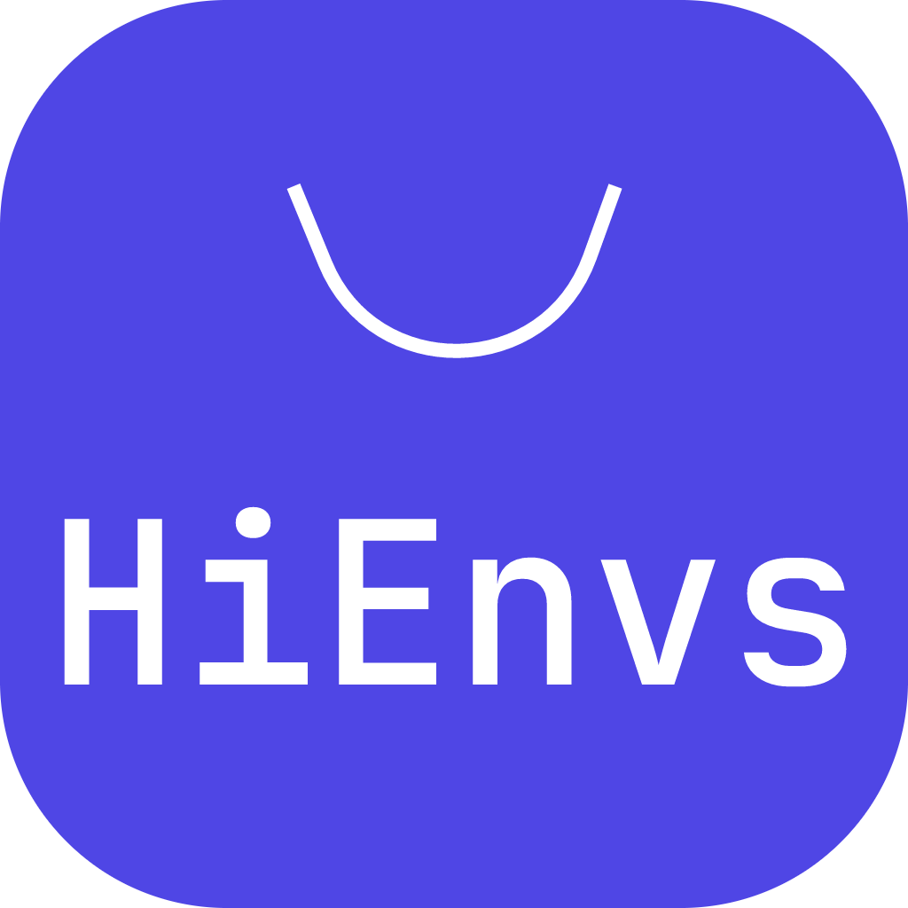

<div align="center">
  
  <h1>HiEnvs</h1>
  <p>开源共建可信软件源 · 跨平台开发环境管理器</p>
  <p><a href="README.md">English</a> · 中文</p>
</div>

## 简介

HiEnvs 是一款基于 Electron + TypeScript 的跨平台开发环境管理工具，通过远程 JSON 清单（软件源）驱动，完成开发工具的**多版本下载、安装、激活与切换**。支持 JDK（多发行商）、Maven、Go、Python、Flutter、Node.js 等多种开发环境工具。

## 特性

- **多版本共存管理**：同一工具多版本并存，一键激活切换，环境变量按需写入/清理
- **软件源机制**：无内置默认源，手动添加并强制校验有效性；多源并行，工具箱内按源/分类（GitHub 风格 tab）过滤浏览
- **多协议下载**：HTTP(S) 直链、BT（magnet / .torrent，基于 webtorrent）、ed2k 链接识别（自动回退其它镜像源）
- **可靠下载**：断点续传、镜像自动回退、md5 / SHA-1 / SHA-256 流式校验、代理（含用户名密码认证）
- **平台感知匹配**：清单平台键支持 `windows-x64` 精确匹配、`windows` 架构无关匹配、`none` 平台通用标识；工具条目还可标记 `systemAgnostic`（如系统镜像），客户端跳过当前平台校验，任意操作系统均可下载该资产
- **工作流编排**：下载 → 解压/安装 → 激活 全流程由清单工作流驱动，任务中心可视化管理、失败可重试
- **国际化**：内置 16 种语言（含中文简/繁、日、韩、法、德、西、葡、俄、波兰、阿拉伯、印地、马来、藏、维吾尔）
- **配套源站点**：`webui/` 内置 Next.js 静态站点，可视化浏览与维护软件源，按地区（语言）切换展示，可直接作为客户端远程源

## 软件源

软件源为远程 JSON 清单（`index.json` + 各工具清单文件），定义工具、版本、平台资产、下载镜像与安装工作流。客户端「设置 → 软件源」中添加源地址，校验通过后自动完成初始化。

## 开发

```bash
npm install
npm run dev          # 启动开发客户端（主进程/preload 改动需完全重启）
npm run typecheck    # 类型检查
npm run test         # 单元测试（vitest）
```

开发环境下客户端会自动注入本地 webui 源（`http://127.0.0.1:4173/zh-CN/index.json`），配合源站点联调：

```bash
cd webui
npm install
npm run build && npx serve out   # 构建并以静态服务预览（端口 4173）
```

## 打包

```bash
npm run dist:win     # Windows（NSIS 安装包）
npm run dist:mac     # macOS
npm run dist:linux   # Linux
```

清单资源通过 `extraResources` 随包分发。

也可通过 GitHub Actions 自动发布：推送 `v*` 标签（如 `git tag v0.1.0 && git push --tags`）即触发 Windows / macOS / Linux 三平台并行构建，产物自动上传至对应 GitHub Release（见 [.github/workflows/release.yml](.github/workflows/release.yml)）。发标签前请先 bump `package.json` 的 `version`。

## 数据目录

| 内容 | 位置 |
| --- | --- |
| 配置 / 缓存 / 日志 | `~/.hienvs/` |
| 下载目录 | 默认 `<安装目录>/.hienvs/downloads`（可在设置中修改） |
| 安装目录 | 默认 `<安装目录>/.hienvs/tools`（可在设置中修改） |

## 技术栈

Electron · electron-vite · React · Tailwind CSS v4 · zustand · zod · undici · webtorrent · Next.js 15（webui 静态导出）

## License

[Apache License 2.0](LICENSE)
